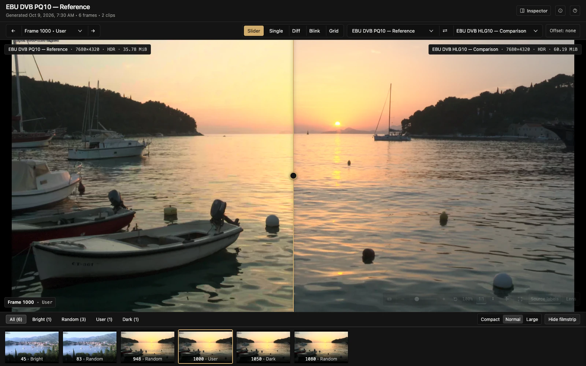

# Frame Compare

[](#installation)
[](LICENSE)
[](https://github.com/TJZine/frame-compare/actions/workflows/ci.yml)

**[Windows portable](docs/getting-started/windows-portable.md)** ·
**[Docker](docs/getting-started/docker.md)** ·
**[Native source](docs/getting-started/native.md)** ·
**[Documentation](https://tjzine.github.io/frame-compare/)**

Frame Compare turns two or more local video sources into a repeatable comparison.
It discovers and validates the sources, selects representative frames, aligns differing
edits when possible, and renders labeled screenshots. It builds a static HTML report
that works without a server. Publishing to slow.pics and webhook notification are
explicit opt-ins.



<sub>Footage: EBU/DVB HEVC test content © EBU, shot by Frans de Jong (EBU), PQ10 conversion by Andrew Cotton (BBC), licensed under [CC BY 4.0](https://creativecommons.org/licenses/by/4.0/).</sub>

## What it does

- Combine exact user frames with deterministic random, dark, bright, and motion selections.
- Apply an automatic audio offset only when the video confirms it, reuse accepted
  offsets, and review the rest in the VSView alignment panel.
- Tonemap HDR sources through VapourSynth and vs-placebo when required, with
  configurable overlays and diagnostics.
- Inspect Slider, Single, Diff, Blink, and Grid views in an offline report, navigate
  by frame or category, zoom, pan, use the lens and Inspector, and keep
  browser-local review notes.
- Use the complete Windows portable bundle or the managed Docker runtime to get the
  media stack without assembling it by hand.

## Installation

| Route | Best for | Start here |
| --- | --- | --- |
| Windows portable | Windows 10/11 x64 users who want the complete supported runtime, VSView, installer, and updater | [Install the Windows portable bundle](docs/getting-started/windows-portable.md) |
| Docker | Reproducible headless use on macOS or Linux, including HDR software tonemapping | [Run with Docker](docs/getting-started/docker.md) |
| Native source | Advanced users who already manage FFmpeg, VapourSynth, source plugins, and Vulkan | [Install from source](docs/getting-started/native.md) |

See [Choose an installation](docs/getting-started/index.md).

## First comparison

Every route follows the same sequence:

1. Put at least two supported video files in the selected input directory.
2. Run `frame-compare wizard` through that route.
3. Run `frame-compare doctor` and resolve relevant failures.
4. Check the sources and what a run would create with `run --dry-run`.
5. Run the comparison and open the generated `report.html`.

The exact commands and expected output are in
[Your first comparison](docs/getting-started/first-comparison.md). Later comparisons
with an established configuration and runtime usually need only the dry run and run; see
[Repeat comparisons](docs/getting-started/first-comparison.md#repeat-comparisons).

## Documentation map

- [How Frame Compare works](docs/guides/how-it-works.md)
- [Sources, references, and labels](docs/guides/sources-and-labels.md)
- [Frame selection and analysis](docs/guides/analysis-modes.md)
- [Audio alignment](docs/guides/audio-alignment.md)
- [VSView alignment review](docs/guides/vsview-review.md)
- [HDR and tonemapping](docs/guides/hdr-tonemapping.md)
- [Reports and overlays](docs/guides/reports-and-overlays.md)
- [Troubleshooting](docs/guides/troubleshooting.md)
- [Commands](docs/reference/commands.md)
- [Configuration](docs/reference/configuration.md)

## Project status

Frame Compare is a beta project. The CLI, documented configuration behavior, and
published release artifacts are the supported surfaces. Importable modules are
conveniences unless the project explicitly documents a compatibility promise.

The verification policy and current architecture are maintained in the
[Engineering runbook](docs/ENGINEERING_RUNBOOK.md) and
[Current architecture](docs/current-architecture.md).

## License

Frame Compare is licensed under the
[GNU General Public License v3.0 only](LICENSE) (`GPL-3.0-only`).

```text
Copyright 2025-2026 Tristan <zine96@proton.me>
```
