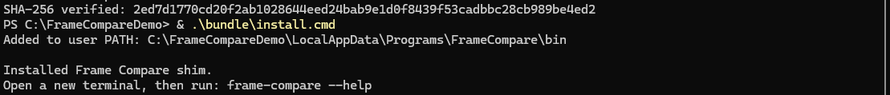

# Windows portable

The Windows portable bundle is the complete Frame Compare distribution for Windows
10 and 11 (x64). It includes Python, the media runtime, VSView with the alignment
panel and an installer.

## Install

[Download the latest release](https://github.com/TJZine/frame-compare/releases/latest){ .md-button .md-button--primary }

<div class="fc-steps" markdown>

1.  **Download both files from the same release.**

    ```text
    frame-compare-portable-win-x64-<tag>.zip
    frame-compare-portable-win-x64-<tag>.zip.sha256
    ```

2.  **Verify the download.**

    Download the ZIP and its matching `.zip.sha256` file from the same release.
    Compare the SHA-256 checksum before extracting the ZIP.

    ??? fc-disclosure "Show the checksum commands"

        ```powershell title="PowerShell · SHA-256 checksum"
        $tag = "<tag>"
        $zip = ".\frame-compare-portable-win-x64-$tag.zip"
        $checksumFile = "$zip.sha256"
        $expected = ((Get-Content -LiteralPath $checksumFile -Raw -Encoding ASCII -ErrorAction Stop).Trim() -split "\s+")[0].ToLowerInvariant()
        $actual = (Get-FileHash -LiteralPath $zip -Algorithm SHA256 -ErrorAction Stop).Hash.ToLowerInvariant()
        if ($expected -notmatch "^[a-f0-9]{64}$" -or $actual -ne $expected) {
            throw "SHA-256 mismatch. Do not install this download."
        }
        "SHA-256 verified: $actual"
        ```

    !!! warning "The hashes must match exactly"

        Delete and download both files again if verification fails; do not bypass the mismatch.

3.  **Extract the ZIP into a fresh, empty folder.**

4.  **Run the installer from the extracted folder.**

    ```powershell title="PowerShell"
    .\install.cmd
    ```

5.  **Open a new terminal.**

    Open a new terminal after installation so the updated user `PATH` is loaded.
    Check the runtime with `frame-compare doctor`.

</div>

<figure class="fc-figure">
  
  <figcaption>Verify the ZIP first, then install the shim and open a new terminal so the updated PATH applies.</figcaption>
</figure>

## Workspace and generated data

The bundle includes empty `config/` and `comparison_videos/` directories.

- Put an existing config at `config/config.toml`.
- Put source videos in `comparison_videos/` to use the default discovery path.
- Use `frame-compare wizard` to create or review configuration.

A bundle-local `config/config.toml` takes precedence over the installed AppData fallback
configuration.

The default generated-data location is the bundle’s `generated/` directory. In the
wizard, set **Generated data location** to a normal external folder when reports,
screenshots, history, run state, and reusable caches must survive bundle replacement.
The installed fallback configuration retains that choice. Installation and
uninstallation leave external user data in place.

A top-level bundle `screenshots/` directory is not a runtime output root. Every executed
comparison writes its canonical `report.html`, sibling `screenshots/`, run records, and
run-local generated state beneath the selected generated-data root.

Moving the bundle or source media can change cache identity because Frame Compare uses
source paths to check freshness and identify requests. Keep existing run folders intact
to view them after a move. A move may prevent cache reuse.

## First comparison

1. Put at least two `.mkv`, `.mp4`, `.avi`, `.m2ts`, or `.ts` files in
   `comparison_videos/`.
2. Open a new PowerShell terminal.
3. Run:

    ```powershell
    frame-compare wizard
    frame-compare doctor
    frame-compare run --dry-run
    frame-compare run
    ```

The first-use configuration keeps slow.pics automatic upload disabled. Review the local
report before enabling any publication integration.

See [Your first comparison](first-comparison.md) for the expected output and
review checklist.

## VSView alignment review

To upgrade from pre-native-panel schema-2 bundles, install the current full ZIP.

The bundle includes VSView, PySide6, and the packaged `frame-compare-alignment-review`
panel entry point in one self-contained Python environment; Frame Compare launches
VSView from that same environment.

A PATH-only VSView executable or a separate Python installation is not supported.

Turn review on with `audio_alignment.use_vsview = true`, or require it for one run with
`--force-interactive-alignment`.

See [VSView alignment review](../guides/vsview-review.md) for the workflow, the saved
result, and troubleshooting.

## Inspect previous runs

```powershell
frame-compare history list
frame-compare history open <run-name>
```

History uses the generated-data root selected by the same effective configuration as the
normal run.

## Update behavior

Close running comparisons before switching bundles. Extract the complete portable
ZIP into a fresh, empty folder. Overlaying a full ZIP onto an existing bundle root is unsupported.

Run `install.cmd` from the fresh extraction. It moves the previous active bundle's
non-empty `config/`, `comparison_videos/`, and `generated/` folders into the new
bundle. Application code and runtime files stay in the old bundle.

Keep both bundles on the same volume. For each non-empty folder the installer
moves, the matching folder in the new bundle must be empty or absent. If either
condition fails, run `install.cmd -UserData Leave` and copy the files you need
by hand.

The installed AppData fallback configuration and external user data are preserved.

### Reactivate a previous bundle

Run `install.cmd` from the bundle you want to reactivate. Installers from
v0.7.0 onward move the same user folders back by default, subject to the same
volume and empty-folder requirements. If both bundles have data in a folder
after using Leave, reactivate with `install.cmd -UserData Leave` and copy the
files you need by hand.

If you reactivate a bundle from before v0.7.0, its installer restores that version and its legacy
update command. Data you moved stays in the newer bundle. Copy the folders
you need back to the older bundle yourself.

Moving source folders can cause path-keyed caches to recompute. If your
configuration contains absolute paths into the previous bundle, update those
paths after the move. If the installer reports a pending migration, use the
paths it reports to locate and recover your files before retrying.

## Uninstall

Run `uninstall.cmd` from the current portable bundle root. It removes the installed user
shim and managed `PATH` entry. It preserves the installed state configuration, unknown
files, the portable bundle, source videos, and any external generated-data root.

## Bundle inventory and licenses

Each complete bundle includes:

- `bundle_info.json` with application and coordinated runtime identity.
  A full bundle with the native panel uses `bundle_info.schema_version` 3;
- `bundle_inventory.json` with exact source commit, runtime artifacts, package versions,
  hashes, byte counts, and license metadata;
- `licenses/SOURCE_URLS.txt` with corresponding-source locations;
- `licenses/THIRD_PARTY_NOTICES.txt` and copied component notices.

The selected profile and compatibility policy are described in
[Supported media runtime](../supported-media-runtime.md). Artifact-level hashes and source
revisions in the build manifest and generated inventory remain authoritative.

## Build the portable bundle from a clone

Use this route only when no suitable published bundle exists or when validating the
packaging path. It requires Windows 10/11 x64, Git, PowerShell 7 or newer, network
access to every pinned upstream artifact, build time, and download-cache space.

From the repository root:

```powershell
.\install.cmd
```

The root command delegates to the source installer, builds
`dist\frame-compare-portable-win-x64-<yyyyMMdd-HHmmss>Z` (UTC), and installs the same user-level shim as a
published bundle. The source route refuses before bootstrap, Python provisioning, or output
changes when PowerShell 7 is unavailable.

The source installer ensures `uv` is on `PATH`, then runs `uv python install 3.13`
before building. It provisions the build interpreter without creating a project
environment or installing development dependencies. The builder requires a discoverable
Python 3.13 and assembles the pinned portable runtime separately.

Use `.\install.cmd -SkipPythonInstall` only when Python 3.13 is already discoverable.
This skips interpreter provisioning; the builder still checks for Python 3.13 without
downloading it. The legacy `-SkipSync` switch remains an alias with the same meaning.

Run a direct source `.ps1` installer with
`pwsh`; Windows PowerShell 5.1 remains supported for published-bundle installation,
launch, and updates.

Each rerun builds and verifies a fresh folder before switching the active-bundle
pointer. The installed shim always selects that active bundle. By default,
non-empty `config/`, `comparison_videos/`, and `generated/` folders move from the
previous active bundle with same-volume renames. Use `.\install.cmd -UserData Leave`
to activate without moving them. Leave keeps data in the previous bundle and may
select an older AppData fallback config if the new bundle has no `config/config.toml`.

Before Python provisioning and building, the source installer acquires an exclusive
activation lock and refuses a pending source-migration marker. It re-reads the active
pointer as one byte snapshot after the build. A source install or current bundle
installer already activating causes a refusal with the lock path and retry guidance.
The lock file may remain after success or a crash; only its open process handle
prevents another activation.

Junctions, symlinks, and mount points in build or previous-bundle ancestry are refused;
choose physical paths so containment can be checked. Stored active pointers must use
fully qualified absolute paths. Drive-relative and root-relative values are malformed.

Move is all-or-nothing for failures and Ctrl+C: a move or activation failure restores
completed moves, empty placeholders, the previous pointer, and its shims. If recovery
fails, the installer stops and reports the pointer and every folder location for manual
repair. After an interrupted migration, the next run refuses installation and reports
the pointer and folder locations; empty candidate placeholders count as unmoved.
A candidate pointer and moved folders do not prove activation finished: configuration
and PATH setup follow pointer publication. Leave that data in the candidate bundle
and retain the marker while checking the candidate's configuration, installed shim,
and user PATH. In a new terminal, confirm `frame-compare` launches the candidate;
only after those checks succeed may you remove the marker before retrying.
When the pointer still names the previous bundle, follow the listed folder-restoration
steps. Conflicting or unreadable pointer state requires a manual check before moving
anything or deleting the marker. If activation succeeds but marker cleanup fails,
the installer reports a cleanup error without reversing data or the pointer.
Cross-volume moves refuse activation; use Leave and relocate data manually.
Moving media makes path-keyed caches recompute once. Absolute paths in config are
not rewritten. Previous bundles are never deleted; remove them manually only once
you have accepted the new installation. A missing or stale active pointer is treated
as a first install.

The direct `build_portable.ps1` command refuses occupied and unsafe output paths.
Remove only disposable build output explicitly before reusing a build path.

Use the source-built bundle as the application workspace:

```text
dist/frame-compare-portable-win-x64-<yyyyMMdd-HHmmss>Z/
├── config/
├── comparison_videos/
├── generated/
├── frame-compare.ps1
└── install.cmd
```

## Bundle contents

The portable graph pins the base `vsview` package and the Frame Compare panel
entry point; its upstream
`recommended` and `full` extras are not bundled. BestSource and vspackrgb serve the
VSView/UI runtime. Frame Compare-generated sessions continue to load comparison media
through L-SMASH-Works and Frame Compare-owned indexes.

## Troubleshooting

| Symptom | Action |
| --- | --- |
| `frame-compare` is not found | Open a new terminal; if still unavailable, rerun `install.cmd` from the bundle’s current location |
| The shim reports a missing bundle | The portable folder moved; rerun `install.cmd` from its new location |
| Source build cannot install `uv` | Install it with `winget install --id astral-sh.uv -e --source winget` or `py -m pip install --user uv`, then rerun the installer |
| No videos are discovered | Put at least two supported video files in `comparison_videos/` or select another contained input directory in the wizard |
| Doctor reports an optional/network warning | Review it against the intended workflow; disabled integrations need no setup |
| Doctor reports a required media component failure | Reinstall the complete bundle rather than mixing unmanaged replacement DLLs into it |
| The alignment panel is missing, stays inactive, or rejects a result | See [VSView alignment review](../guides/vsview-review.md#troubleshooting) |
| Reports disappeared after replacing the bundle | Check the previous bundle and the configured generated-data location for the run folders |

For broader diagnosis, see [Troubleshooting](../guides/troubleshooting.md).
