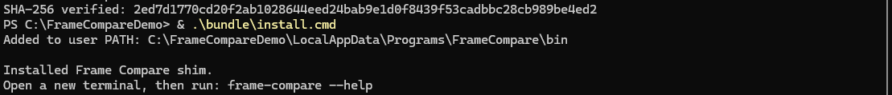

# Windows portable

The Windows portable bundle is the complete Frame Compare distribution for Windows
10 and 11 (x64). It includes Python, the media runtime, VSView with the alignment
panel, an installer, and signed code-only updates.

## Install

[Download the latest release](https://github.com/TJZine/frame-compare/releases/latest){ .md-button .md-button--primary }

<div class="fc-steps" markdown>

1.  **Download both files from the same release.**

    ```text
    frame-compare-portable-win-x64-<tag>.zip
    frame-compare-portable-win-x64-<tag>.zip.sha256
    ```

2.  **Verify the download.**

    On an internet-connected machine with the GitHub CLI installed,
    confirm that this repository's Windows build workflow produced the ZIP, then
    compare its SHA-256 checksum.

    ??? fc-disclosure "Show the verification commands"

        ```powershell title="PowerShell · release provenance"
        $tag = "<tag>"
        $zip = ".\frame-compare-portable-win-x64-$tag.zip"
        # Resolve the selected lightweight refs/tags/<tag> ref through GitHub.
        $tagSha = @(gh api "repos/TJZine/frame-compare/git/ref/tags/$tag" --jq ".object.sha")
        if ($LASTEXITCODE -ne 0) {
            throw "Could not resolve release tag $tag. Do not install this download."
        }
        if ($tagSha.Count -ne 1) {
            throw "Release tag $tag did not resolve to exactly one commit SHA. Do not install this download."
        }
        $tagSha = $tagSha[0].Trim()
        if ($tagSha -notmatch "^[0-9a-f]{40}$") {
            throw "Release tag $tag resolved to an invalid commit SHA. Do not install this download."
        }
        gh attestation verify $zip `
          --repo TJZine/frame-compare `
          --signer-workflow TJZine/frame-compare/.github/workflows/windows-portable-build.yml `
          --source-digest $tagSha
        if ($LASTEXITCODE -ne 0) {
            throw "Release provenance verification failed. Do not install this download."
        }
        ```

        Then verify the ZIP checksum before extracting it:

        ```powershell title="PowerShell · SHA-256 checksum"
        $zip = ".\frame-compare-portable-win-x64-$tag.zip"
        $checksumFile = "$zip.sha256"
        $expected = ((Get-Content -LiteralPath $checksumFile -Raw).Trim() -split "\s+")[0].ToLowerInvariant()
        $actual = (Get-FileHash -LiteralPath $zip -Algorithm SHA256).Hash.ToLowerInvariant()
        if ($actual -ne $expected) {
            throw "SHA-256 mismatch. Do not install this download."
        }
        "SHA-256 verified: $actual"
        ```

    !!! warning "The hashes must match exactly"

        Delete and download both files again if verification fails; do not bypass the mismatch.

3.  **Extract the ZIP into a fresh, empty folder.**

4.  **Run the installer from the extracted folder.**

    ```powershell title="PowerShell"
    .\install.cmd
    ```

5.  **Open a new terminal.**

    Open a new terminal after installation so the updated user `PATH` is loaded.
    Check the runtime with `frame-compare doctor`.

</div>

<figure class="fc-figure">
  
  <figcaption>Verify the ZIP first, then install the shim and open a new terminal so the updated PATH applies.</figcaption>
</figure>

## Workspace and generated data

The bundle includes empty `config/` and `comparison_videos/` directories.

- Put an existing config at `config/config.toml`.
- Put source videos in `comparison_videos/` to use the default discovery path.
- Use `frame-compare wizard` to create or review configuration.

A bundle-local `config/config.toml` takes precedence over the installed AppData fallback
configuration.

The default generated-data location is the bundle’s `generated/` directory. In the
wizard, set **Generated data location** to a normal external folder when reports,
screenshots, history, run state, and reusable caches must survive bundle replacement.
The installed fallback configuration retains that choice. The updater, rollback flow,
reinstall path, and uninstaller leave that external root untouched.

A top-level bundle `screenshots/` directory is not a runtime output root. Every executed
comparison writes its canonical `report.html`, sibling `screenshots/`, run records, and
run-local generated state beneath the selected generated-data root.

Moving the bundle or source media can change cache identity because Frame Compare uses
source paths to check freshness and identify requests. Keep existing run folders intact
to view them after a move. A move may prevent cache reuse.

## First comparison

1. Put at least two `.mkv`, `.mp4`, `.avi`, `.m2ts`, or `.ts` files in
   `comparison_videos/`.
2. Open a new PowerShell terminal.
3. Run:

    ```powershell
    frame-compare wizard
    frame-compare doctor
    frame-compare run --dry-run
    frame-compare run
    ```

The first-use configuration keeps slow.pics automatic upload disabled. Review the local
report before enabling any publication integration.

See [Your first comparison](first-comparison.md) for the expected output and
review checklist.

## VSView alignment review

The bundle includes VSView, PySide6, and the packaged `frame-compare-alignment-review`
panel entry point in one self-contained Python environment; Frame Compare launches
VSView from that same environment.

A PATH-only VSView executable or a separate Python installation is not supported.

Turn review on with `audio_alignment.use_vsview = true`, or require it for one run with
`--force-interactive-alignment`.

See [VSView alignment review](../guides/vsview-review.md) for the workflow, the saved
result, and troubleshooting.

## Inspect previous runs

```powershell
frame-compare history list
frame-compare history open <run-name>
```

History uses the generated-data root selected by the same effective configuration as the
normal run.

## Update behavior

Frame Compare has two Windows update boundaries:

| Update type | Replaces | Use it when |
| --- | --- | --- |
| Complete portable ZIP | Application plus Python, FFmpeg, VapourSynth, VSView/PySide6, plugins, manifests, and native license payloads | The release changes the media-runtime/dependency fingerprint or a clean reinstall is required |
| Signed code-only ZIP | Application code and packaged Python project files only | The installed complete bundle already carries the exact required media-runtime fingerprint |

Apply a code-only update:

```powershell
frame-compare-update apply .\frame-compare-update-win-x64-<tag>.zip
```

??? fc-disclosure "Why an update can be refused"

    The updater bounds the archive and its two fixed authentication entries, then verifies
    the signature before parsing the manifest or inspecting and extracting payload entries.
    It verifies every payload hash before replacement. Unsigned packages have no interactive
    bypass. Archive compressed size, entry count, per-entry and total
    uncompressed size, and compression ratio are bounded before extraction.

    It accepts only
    a native-panel-capable full bundle (`bundle_info.schema_version` 3) and refuses
    pre-native-panel schema-2 bundles, as well as missing, malformed, or different
    media-runtime fingerprints, before applying any change. That refusal cannot be
    overridden safely because a code-only ZIP does not carry replacement native media
    components. An unavailable installed app version also fails closed instead of skipping
    the signed source-version range; install the complete portable ZIP instead.

When the fingerprint differs, install the complete portable ZIP for that release into a
fresh, empty folder. Overlaying a full ZIP onto an existing bundle root is unsupported.

Before a full reinstall:

1. Preserve the old bundle and its user configuration, source videos, and generated data.
2. Copy your `config/config.toml` and any bundle-local inputs or `generated/` data into
   the new bundle as needed, or retain their external locations.
3. Leave application code, runtime files, and update backups in the old bundle.
4. Run the new bundle's `install.cmd` to point the installed shim at it.

The installed AppData fallback configuration and external user data are preserved.
Keep **Generated data location** external when reports and reusable state must survive
replacement.

## Backup and rollback

```powershell
frame-compare-update list-backups
frame-compare-update rollback <backup-id>
frame-compare-update purge-backups --keep 5
```

Each code-update backup records the media-runtime and requirements-lock identity of
the bundle that created it. `list-backups` marks backups with missing, malformed, or
different identity as unavailable. `rollback` refuses those backups before changing any
file. Identity-less legacy backups cannot be restored or migrated.

Compatible backups restore only application code; rollback is not a substitute for a
complete bundle reinstall across different runtime or dependency fingerprints.

## Uninstall

Run `uninstall.cmd` from the current portable bundle root. It removes the installed user
shim and managed `PATH` entry. It preserves the installed state configuration, unknown
files, the portable bundle, source videos, and any external generated-data root.

## Bundle provenance and licenses

Each complete bundle includes:

- `bundle_info.json` with application and coordinated runtime identity;
- `bundle_inventory.json` with exact source commit, runtime artifacts, package versions,
  hashes, byte counts, and license metadata;
- `licenses/SOURCE_URLS.txt` with corresponding-source locations;
- `licenses/THIRD_PARTY_NOTICES.txt` and copied component notices.

The selected profile and compatibility policy are described in
[Supported media runtime](../supported-media-runtime.md). Artifact-level hashes and source
revisions in the build manifest and generated inventory remain authoritative.

## Build the portable bundle from a clone

Use this route only when no suitable published bundle exists or when validating the
packaging path. It requires Windows 10/11 x64, Git, PowerShell 7 or newer, network
access to every pinned upstream artifact, build time, and download-cache space.

From the repository root:

```powershell
.\install.cmd
```

The root command delegates to the source installer, builds
`dist\frame-compare-portable-win-x64-<yyyyMMdd-HHmmss>Z` (UTC), and installs the same user-level shim as a
published bundle. The source route refuses before bootstrap, dependency sync, or output
changes when PowerShell 7 is unavailable.

Run a direct source `.ps1` installer with
`pwsh`; Windows PowerShell 5.1 remains supported for published-bundle installation,
launch, and updates.

Each rerun builds and verifies a fresh folder before switching the active-bundle
pointer. The installed shim always selects that active bundle. By default,
non-empty `config/`, `comparison_videos/`, and `generated/` folders move from the
previous active bundle with same-volume renames. Use `.\install.cmd -UserData Leave`
to activate without moving them. Leave keeps data in the previous bundle and may
select an older AppData fallback config if the new bundle has no `config/config.toml`.

After building, the source installer acquires an exclusive activation lock and
re-reads the active pointer as one byte snapshot. A source install or current bundle
installer already activating causes a refusal with the lock path and retry guidance.
The lock file may remain after success or a crash; only its open process handle
prevents another activation. Builds can proceed before this activation boundary.

Junctions, symlinks, and mount points in build or previous-bundle ancestry are refused;
choose physical paths so containment can be checked. Stored active pointers must use
fully qualified absolute paths. Drive-relative and root-relative values are malformed.

Move is all-or-nothing. A move or activation failure restores completed moves,
empty placeholders, the previous pointer, and its shims. If recovery fails, the
installer stops and reports the pointer and every folder location for manual repair.
Cross-volume moves refuse activation; use Leave and relocate data manually.
Moving media makes path-keyed caches recompute once. Absolute paths in config are
not rewritten. Previous bundles are never deleted; remove them manually only once
you have accepted the new installation. A missing or stale active pointer is treated
as a first install.

The direct `build_portable.ps1` command refuses occupied and unsafe output paths.
Remove only disposable build output explicitly before reusing a build path.

Use the source-built bundle as the application workspace:

```text
dist/frame-compare-portable-win-x64-<yyyyMMdd-HHmmss>Z/
├── config/
├── comparison_videos/
├── generated/
├── frame-compare.ps1
└── install.cmd
```

## Bundle contents

The portable graph pins the base `vsview` package and the Frame Compare panel
entry point; its upstream
`recommended` and `full` extras are not bundled. BestSource and vspackrgb serve the
VSView/UI runtime. Frame Compare-generated sessions continue to load comparison media
through L-SMASH-Works and Frame Compare-owned indexes.

## Troubleshooting

| Symptom | Action |
| --- | --- |
| `frame-compare` is not found | Open a new terminal; if still unavailable, rerun `install.cmd` from the bundle’s current location |
| The shim reports a missing bundle | The portable folder moved; rerun `install.cmd` from its new location |
| Source build cannot install `uv` | Install it with `winget install --id astral-sh.uv -e --source winget` or `py -m pip install --user uv`, then rerun the installer |
| No videos are discovered | Put at least two supported video files in `comparison_videos/` or select another contained input directory in the wizard |
| Doctor reports an optional/network warning | Review it against the intended workflow; disabled integrations need no setup |
| Doctor reports a required media component failure | Reinstall the complete bundle rather than mixing unmanaged replacement DLLs into it |
| Code-only update reports a runtime mismatch | Install the complete portable ZIP for that release |
| The alignment panel is missing, stays inactive, or rejects a result | See [VSView alignment review](../guides/vsview-review.md#troubleshooting) |
| Reports disappeared after replacing the bundle | Configure an external generated-data root and restore the prior run folders from backup if available |

For broader diagnosis, see [Troubleshooting](../guides/troubleshooting.md).
