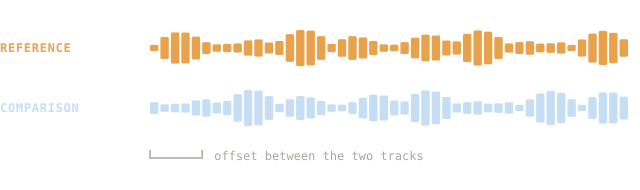

# Audio alignment

Frame Compare estimates the offset between the reference and each comparison from their
audio. Frame Compare applies a fresh automatic offset only when video confirmation and
all other authority checks pass. It changes which source frames are compared without
retiming or rewriting the files.

<figure class="fc-figure">
  
  <figcaption>The offset is the shift between the two tracks. The waveform is illustrative.</figcaption>
</figure>

## When alignment helps

Use alignment when sources contain the same program but differ because of:

- leading studio logos or broadcaster slates;
- different container start times;
- source-specific trims;
- a constant audio/video offset;
- short additional or missing sections before the shared content.

It is not a general edit-matching system. Different cuts, replaced music, silence,
commentary tracks, or unrelated audio can make correlation ambiguous or invalid.

## What the results mean

The terminal distinguishes applied offsets from candidates that still need review:

| Terminal result | Meaning | What to do |
| --- | --- | --- |
| `Audio alignment accepted: +Nf - APPLIED` | All automatic authority checks pass; the trims use the offset | Check a few frames in the report |
| `Provisional audio candidate: +Nf - NOT APPLIED` | A candidate exists, but at least one authority check fails; video may still confirm it | Review it in the VSView alignment panel, or keep the current alignment |
| `No usable audio candidate (<reason>) - NOT APPLIED` | No offset could be established | Check the audio streams, or align manually in the panel |
| `Accepted audio alignment reused: +Nf - APPLIED` | An offset accepted in an earlier run still matches | Nothing |
| `Manually confirmed alignment: +Nf - APPLIED` | An offset confirmed in the panel is in use | Nothing |
| `Manually confirmed alignment reused: +Nf - APPLIED` | An offset confirmed in the panel in an earlier run still matches | Nothing |

Each line starts with `Comparison N - `. A `+0f` result is a real zero offset, not a
missing one. `--verbose` adds the evidence counts and `--quiet` keeps only actionable
warnings.

Frame Compare decodes the whole audio and compares it in chunks, then checks the exact
offset with a sample of decoded frames. It requires video confirmation and a passed
audio authority recount before applying an automatic offset. It also requires resolved
competing runs and credible chunk disagreements, and no confirmed alternative offset.

Video confirmation alone does not authorize application or writing the candidate to
the computed-offset cache.
The exact thresholds live in the
[contract](../current-cli-contract.md#config-only-audio-alignment-surface).

## Choose the audio streams

Frame Compare uses the audio streams selected in your configuration. Confirm that the
sources are using corresponding language, mix, and content. A stereo theatrical mix and
a commentary track can correlate poorly even when the video is the same.

Without overrides, the reference switches from its default-ranked stream to its
best-ranked stream in a shared language when its default language is missing from the
comparison.

When automatic stream selection is unsuitable, set the audio-alignment keys documented
in the
[CLI behavioral contract](../current-cli-contract.md#config-only-audio-alignment-surface).

```toml
[audio_alignment]
reference_stream = 1
comparison_streams = { "Encode-A" = 0 }
```

`comparison_streams` keys are filename stems. Stream numbers count audio streams from 0.

## Sources with different frame rates

Set `match_fps` or `effective_fps` first. Frame Compare then stretches the audio onto the
effective timeline, so a 24 fps release of 23.976 content or a PAL 25 fps release keeps
a constant offset. Drift for other reasons is not applied. See
[Sources, references, and labels](sources-and-labels.md#correct-timing-metadata).

## Reuse an accepted offset

Frame Compare caches an applied automatic offset and reuses it whenever the source
files, trims, effective FPS, stream choices, alignment settings, and runtime still match.
It recomputes the alignment on a cache miss and ignores corrupt entries with a warning.

Frame Compare also caches offsets confirmed in the panel, but reuses them only when
`previous_offsets` is `prompt` or `always`. The default `disabled` never reuses them.
Frame Compare never caches provisional or unavailable results.

## Review the evidence

Each run writes `alignment_diagnostics/comparison-<n>.json` in the run folder for every
computed attempt. It contains no media paths, audio, or credentials; its source digests
are pseudonymous, and editing or deleting it changes nothing.

During verification, inspect multiple evidence points:

- a hard cut near the beginning;
- dialogue with visible mouth movement;
- a motion-heavy sequence;
- a later point in the program to detect drift;
- the final shared section to confirm the sources still overlap.

An offset that looks correct at one frame can still be wrong for variable timing or a
different edit.

For visual confirmation, use [VSView alignment review](vsview-review.md).

Use automatic correlation as a starting point for visual review.
For a publication-bound comparison, manually check the final report even when the
alignment cache hits and no warning is emitted.

## Common problems

| Symptom | Likely cause | Action |
| --- | --- | --- |
| Low or unstable correlation | Silence, replaced music, wrong stream, or different edit | Select corresponding audio, increase evidence, or verify manually |
| Good early match but later drift | FPS or timing mismatch | Recheck effective FPS and source structure; do not treat a constant offset as sufficient |
| The VSView panel will not open or rejects a result | Panel setup or session problem | See [VSView alignment review](vsview-review.md#troubleshooting) |
| Reused offset no longer looks correct | Source or runtime changed outside the reusable identity assumptions | Reject reuse, clear the alignment cache entry, and recompute |
| Selected frames disappear after alignment | Shared overlap is smaller than the initial reference-domain plan | Reduce trims or requested counts and review the warning/error context |
