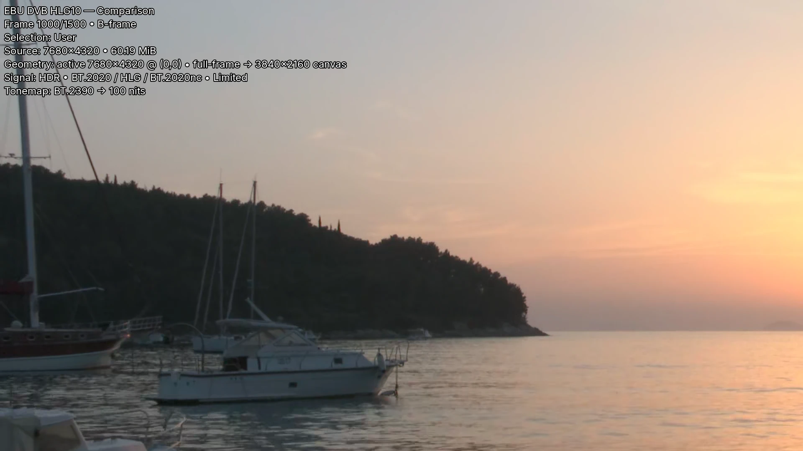

# HDR and tonemapping

Frame Compare turns HDR sources into SDR screenshots so you can compare them in one
browser report. It tonemaps a source with vs-placebo when the source's properties show
that it is HDR.

## What the pipeline does

You can review sources with different HDR metadata or delivery formats in the same
browser report. Frame Compare uses the selected VapourSynth and vs-placebo path for
HDR tonemapping.

1. Probe container metadata and source-frame properties.
2. Preserve explicit frame evidence and fill only missing or unspecified color facts.
3. Decide whether the frame requires HDR-to-SDR conversion.
4. Convert to the working color representation without unnecessary 8-bit reduction.
5. Apply the configured vs-placebo tonemapping preset and target luminance.
6. Convert the native SDR destination's BT.1886 samples to full-range sRGB before
   reducing to RGB8, then render the screenshot and selected overlay.

Screenshot rendering gives each source frame its own native mapper state. Random
access, helper reads of frame zero, parallel requests and cache eviction cannot
carry peak-detector history from another frame into a screenshot. Preset controls
remain unchanged; the report records `independent_frames` as the applied frame
policy. This is a still-image rendering policy, not chronological playback with
temporal smoothing.

## Fast screenshots

For a large still-image batch, set `color.tonemap_speed = "fast"` or pass
`--tm-speed fast`. Fast mode turns off dynamic peak detection and lets libplacebo use
per-frame stream metadata when available, then static HDR metadata, then the resolved
source-peak default. Still preparation can therefore share one stateless native
mapper, and the report records `shared_stateless` as
**Shared (metadata peak, no per-frame measurement)**. This is faster and reproducible,
but it can look different from `quality`, which measures each frame independently;
inspect scenes where the source peak changes. If no HDR peak metadata is available,
the report calls out use of the default 1000-nit peak and the run log warns about it.
The setting is independent of the tone curve, target, and preset, and the degraded
fallback continues to ignore it.

VSView alignment previews also use these configured tone settings for HDR sources
when tonemapping is enabled. Fast previews use the same metadata peak policy as
fast screenshots. Quality previews retain temporal sequence measurement; quality
screenshots measure each still independently, so their appearance can differ.
Mapping occurs before alignment labels and preserves sRGB output properties.
SDR sources, disabled tonemapping and older sessions without tone settings keep
their existing preview handling. Source frame positions and alignment decisions
are unchanged.

The sRGB conversion uses the native destination's configured black and white
endpoints: the selected black maps to sRGB zero and white to one. It preserves
BT.709 primaries and D65. It changes the representation for browser images, not
the tone curve or the source grade, and does not set a monitor's physical
luminance. Pillow PNGs declare sRGB; an untagged PNG from the fpng writer also
contains sRGB samples. Original source metadata remains available in diagnostics;
converted SDR frames no longer claim PQ/BT.2020 or carry source HDR metadata.

This conversion applies only to the known vs-placebo SDR destination. Existing SDR
sources and the separately identified degraded fallback keep their existing
interpretation; they are not assigned the native mapper's black point or passed
through this conversion.

The FFmpeg fallback leaves ambiguous transfer or primaries metadata unknown. It does
not treat that metadata as ordinary SDR.

## Runtime requirements

HDR tonemapping requires:

- VapourSynth;
- the supported vs-placebo plugin;
- a compatible Vulkan implementation and driver;
- source loading through the selected supported runtime.

The Windows portable bundle includes the selected application and plugin stack but still
uses the host Vulkan-capable graphics environment. The default Docker route uses the
canonical software-Vulkan path. For a native installation, you manage the host setup.

Run `frame-compare doctor` after installation and after any graphics-driver, Vulkan,
VapourSynth, source-plugin, or vs-placebo change.

## Configure the result

The wizard does not configure tonemapping. Choose a preset in `[color]`, save it in a
preset, or override it for one run with `--tm-preset`, `--tm-target`, and `--tm-curve`.

The preset sets every value; `target_nits`, `tone_curve`, `gamma_lift`, and
`contrast_recovery` override it only when explicitly supplied in the configuration file
or environment variables. `--tm-target` and `--tm-curve` take precedence for one run;
`--tm-preset` replaces only the preset, and explicitly supplied configuration values
still override it (source: `src/frame_compare/render/prepare.py:37-74`).

| Preset | Curve | Target | Gamma lift |
| --- | --- | --- | --- |
| `reference` (default) | `bt2390` | 100 nits | Off |
| `bt2390_spec` | `bt2390` | 100 nits | Off |
| `filmic` | `spline` | 203 nits | Off |
| `spline` | `spline` | 203 nits | Off |
| `contrast` | `reinhard` | 203 nits | Off |
| `highlight_guard` | `spline` | 180 nits | Off |
| `bright_lift` | `bt2390` | 250 nits | On |

```toml
[color]
preset = "filmic"
target_nits = 160
```

This keeps the `filmic` curve and replaces only its target.

`enable_tonemap = false` renders HDR sources without conversion; the FFmpeg screenshot
path (`screenshots.use_ffmpeg = true`) requires it for HDR sources (source:
`src/frame_compare/render/prepare.py:283`, `src/frame_compare/vs/errors.py:63`).

Use one consistent target and preset for every source in a comparison unless the goal is
specifically to study different conversions. See the
[Configuration](../reference/configuration.md#color) reference.

## HDR versus SDR sources

Comparing an HDR source with an SDR source is valid only after deciding what question
the
comparison should answer:

- **Encode fidelity after a common SDR presentation transform**: tonemap the HDR source
  and review both as SDR screenshots.
- **Native HDR mastering differences**: static SDR screenshots are insufficient; use
  HDR-aware playback and measurement outside this report workflow.
- **Metadata correctness**: use diagnostic overlays and recorded properties, but do not
  infer perceptual equivalence from metadata alone.

Frame Compare's report presents SDR screenshots for browser review.

## Dolby Vision considerations

Frame Compare records source-level DV RPU presence on the **Signal** line. The **Frame**
tab in the **Inspector** records exact selected-frame RPU presence when the VapourSynth
source exposes it. Geometry shows a DV L5-derived active picture as `DV L5`.
Frame Compare does not present L1, L2, or L6 values from a frame-0 probe snapshot as
though they came from the selected frame.

Frame Compare requires documented provider semantics and exact selected source-frame
access before presenting dynamic L1/L2/L6 values. Those values also require correct
types and units, independent frame-specific validation, repeatability, clean negative
cases, and bounded access without scanning. Frame Compare omits values with insufficient
evidence. It includes no raw-RPU parser to populate the UI.

For publication-bound comparisons:

- record whether a compatible HDR10/base layer was used;
- inspect several dark and bright scenes;
- check for raised blacks, clipped highlights, hue shifts, and range mistakes;
- validate the result on the physical Windows/GPU environment intended for release.

## Applied transforms and fallback

The pre-run preview shows your requested preset and settings. Reports disclose the
transform that actually ran for each source, including its resolved source peak and
origin. If vs-placebo is missing, unusable, or fails at runtime, Frame Compare uses
its existing peak-scaled fallback and emits one render warning naming the affected
sources and causes. The fallback is labeled **fallback (peak-scaled)**, rather than
as the requested BT.2390, Spline, or Reinhard curve. It uses source peak, target nits,
and gamma lift; other requested plugin controls do not become effective fallback
controls. Configuration and signature errors still fail the run.

## Overlays and measurements

`diagnostic` overlays can include observed mastering metadata, MaxCLL/MaxFALL, source
color evidence, source-level RPU presence, DV L5 geometry provenance, applied tonemap
settings, and selection context. Exact-frame RPU presence stays in the **Frame** tab of
the
**Inspector** to keep baked overlays concise.

Dynamic Dolby Vision values require exact selected-frame provenance. Frame Compare omits
missing values without placeholders or fabricated defaults.

<figure class="fc-figure">
  
  <figcaption>A diagnostic overlay bakes the observed signal and the applied tonemap into the screenshot. The target nits describe the output transform, not measured luminance. Footage © EBU, CC BY 4.0.</figcaption>
</figure>

Selection scores explain why Frame Compare chose a frame. Use calibrated luminance
measurement, VMAF, or a perceptual review to assess the result; selection scores cannot
replace them. Frame Compare does not derive pseudo-nits from selection scores. A tonemap
target such as 100 or 203 nits sets
the output transform; it does not measure source-frame luminance.

## Common problems

| Symptom | What to check |
| --- | --- |
| Tonemapping plugin unavailable | Run `doctor`; verify the selected vs-placebo plugin and runtime profile |
| Vulkan initialization fails | Update or repair the host Vulkan driver/runtime; use the supported software-Vulkan Docker path where appropriate |
| HDR frame is rendered as SDR without conversion | Inspect transfer, primaries, matrix, and range evidence; do not force a conclusion from partial metadata |
| Output looks washed out or crushed | Check full/limited range interpretation, source metadata, and target/preset choices |
| Different sources show inconsistent hue or brightness | Confirm both pass through the intended common transform and that one source is not being double-tonemapped |
| Docker output differs from Windows | Remember that the routes use different Vulkan implementations and may not be pixel-identical |

The authoritative component matrix and profile policy are in
[Supported media runtime](../supported-media-runtime.md).
