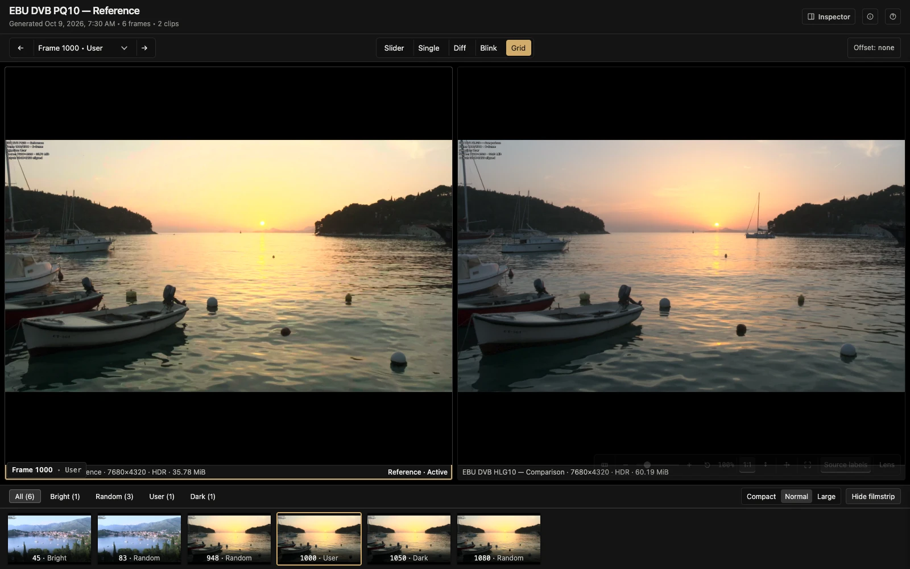
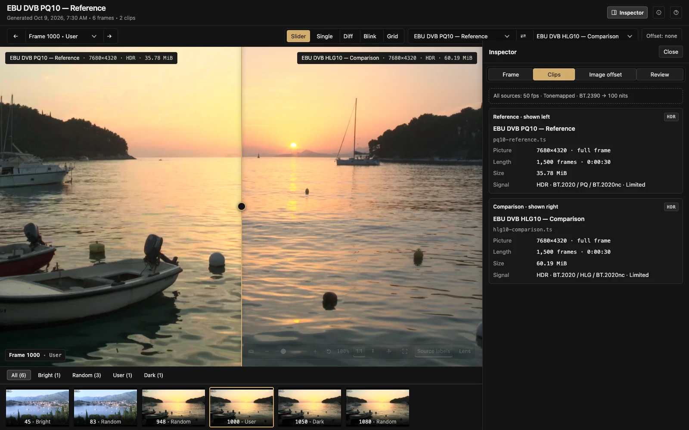
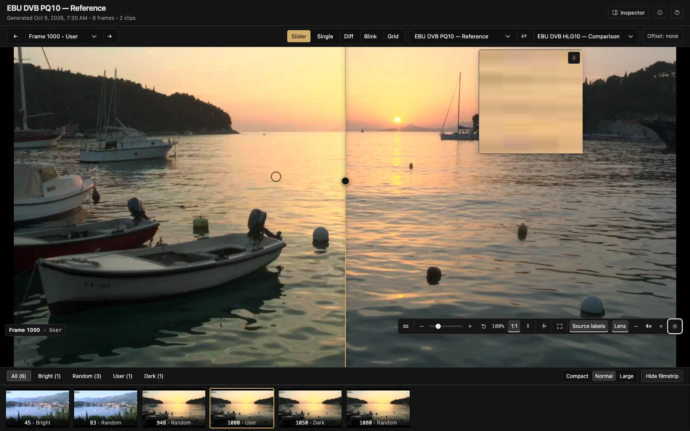
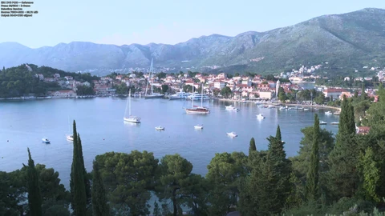
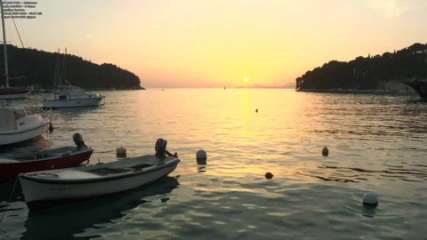
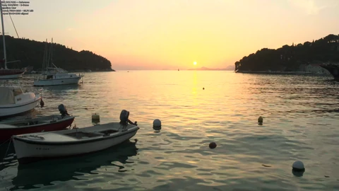
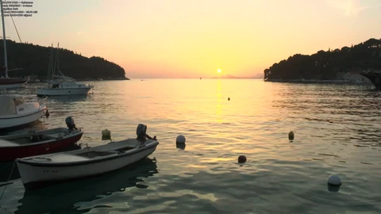
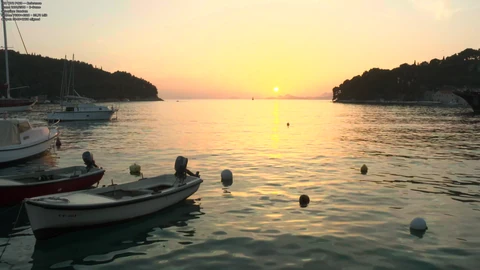

<div class="fc-home" markdown>

## Report views

Each run writes one `report.html` with every rendered frame for every source. You
switch views inside the report.

=== "Slider"

    <figure class="fc-figure">
      
      <figcaption>Use Slider for crop, scaling, haloing, texture, grain, and tone. Footage © EBU, CC BY 4.0.</figcaption>
    </figure>

=== "Grid"

    <figure class="fc-figure">
      
      <figcaption>Use Grid to find the source that differs, then compare it in Slider. Footage © EBU, CC BY 4.0.</figcaption>
    </figure>

=== "Inspector"

    <figure class="fc-figure">
      
      <figcaption>The Clips tab lists each source's size, length, and HDR signal. Footage © EBU, CC BY 4.0.</figcaption>
    </figure>

=== "Lens"

    <figure class="fc-figure">
      
      <figcaption>Drag the lens grip to move the window. Footage © EBU, CC BY 4.0.</figcaption>
    </figure>

## How a comparison runs

<div class="fc-features" markdown>

<div class="fc-feature" markdown>

<div class="fc-feature__visual">
  <ol class="fc-strip" aria-label="Frames selected in the example run">
    <li>45 · Bright</li>
    <li>83 · Random</li>
    <li>948 · Random</li>
    <li class="fc-strip__user">1000 · User</li>
    <li>1050 · Dark</li>
    <li>1080 · Random</li>
  </ol>
</div>

### Frame selection

Name frames by number, or let Frame Compare add random, dark, bright, and motion
frames. The same seed selects the same frames.

[Frame selection and analysis](guides/analysis-modes.md)

</div>

<div class="fc-feature" markdown>

<div class="fc-feature__visual">
  
</div>

### Audio alignment

Frame Compare estimates each comparison's offset from its audio. The offset is
applied only when the video confirms it and every other check passes; otherwise the
run reports `NOT APPLIED` and you review it.

[Audio alignment](guides/audio-alignment.md)

</div>

<div class="fc-feature" markdown>

<div class="fc-feature__visual">
  
</div>

### HDR tonemapping

PQ and HLG sources are tonemapped with vs-placebo. The diagnostic overlay prints the
detected signal and the applied tonemap on each screenshot.

[HDR and tonemapping](guides/hdr-tonemapping.md)

</div>

<div class="fc-feature" markdown>

<div class="fc-feature__visual" markdown>

```text
pq10-reference + hlg10-comparison/
├── report.html
├── screenshots/
├── generated/
├── run_info.toml
└── run_result.toml
```

</div>

### Offline report

Each run writes its own folder. The report links to its screenshots by relative
path, so you can move or archive the folder as a whole.

[Output layout](reference/output-layout.md)

</div>

</div>

## Install

Every route follows the same four steps. The routes differ in who provides Python and
the media libraries.

<div class="fc-cards" markdown>

- [Windows portable](getting-started/windows-portable.md)

    Complete runtime, VSView alignment panel, installer, and signed code-only
    updates. Use this on Windows 10 or 11.

- [Docker](getting-started/docker.md)

    Headless runtime with software Vulkan for HDR. Reports stay on the host. Use
    this on macOS and Linux.

- [Native source](getting-started/native.md)

    Bring your own FFmpeg, VapourSynth, L-SMASH-Works, vs-placebo, and Vulkan. Use
    this if you already run VapourSynth.

</div>

## Your first comparison

Run these commands in order. The dry run shows the sources, the reference, and the
frames you asked for, without opening the videos.

=== "Windows portable"

    ```powershell
    frame-compare wizard           # set the input folder, reference, and frames
    frame-compare doctor           # check the media runtime
    frame-compare run --dry-run    # list what a run would do
    frame-compare run              # run the comparison
    ```

=== "Docker"

    ```bash
    export FRAME_COMPARE_HOST_UID="$(id -u)"
    export FRAME_COMPARE_HOST_GID="$(id -g)"
    mkdir -p config comparison_videos generated
    docker compose build frame-compare-run
    docker compose run --rm frame-compare-wizard
    docker compose run --rm frame-compare-run doctor
    docker compose run --rm frame-compare-run run --root /workspace --dry-run
    docker compose run --rm frame-compare-run run --root /workspace
    ```

=== "Native with uv"

    ```bash
    uv run --no-sync frame-compare wizard
    uv run --no-sync frame-compare doctor
    uv run --no-sync frame-compare run --root . --dry-run
    uv run --no-sync frame-compare run --root .
    ```

[Your first comparison](getting-started/first-comparison.md) covers each stage and
the Docker setup.

## Reference

<div class="fc-cards" markdown>

- [Configuration](reference/configuration.md)

    Each key with its values and default.

- [Commands](reference/commands.md)

    Every command and option.

- [Exit codes](reference/commands.md#exit-codes)

    Codes returned to scripts.

- [Troubleshooting](guides/troubleshooting.md)

    Problems listed by stage.

</div>

</div>
