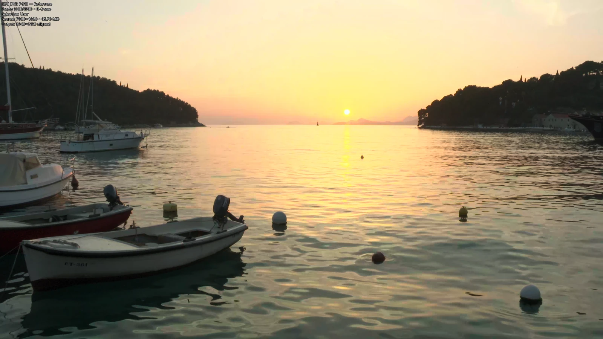

---
search:
  exclude: true
---

# Documentation site redesign: asset specification

Part of the [documentation site redesign plan](../2026-10-12-documentation-site-redesign.md).
Unit U2 produces every file in this specification on macOS. No new capture run is
needed: every image derives from the accepted 2026-10-09 capture set or is generated
from text in this file.

## Prerequisites

- Unit U1 is integrated: `docs/assets/fonts/*.woff2` and `docs/assets/brand/logo.svg`
  exist and match the [theme specification](theme.md).
- Google Chrome at `/Applications/Google Chrome.app` (record `--version`).
- The accepted capture run folder exists at
  `.tmp/docs-refresh-2026-10-08/capture/accepted-u1-generated/pq10-reference + hlg10-comparison/`.
  Verify these source screenshots in its `screenshots/` folder before starting. Any
  missing file or hash mismatch is a stop.

| File | SHA-256 |
| --- | --- |
| `1000 - pq10-reference.png` | `63b7083f67f370471868421f2eaecbfc83d3fd982eea5b5d5da3f235f31dff2e` |
| `1000 - hlg10-comparison.png` | `dc2973fd99354d61ecc7be0ffc95b95d124562ab67a296a9f9abae618c4c8aef` |
| `45 - pq10-reference.png` | `828017e6e6f1e2efac7ed39f74eaefe176d2d758c0da4b71a2e2b29cb3a0ac76` |
| `83 - pq10-reference.png` | `2ac9ee8b0405bda6c1807879b159a4bfcad6daf2de5c3aadd8b4d25adad2b2de` |
| `948 - pq10-reference.png` | `89ce35b5de24bf6509d12530e33e559aa9b1e0552d6b49762750e7fe83d15864` |
| `1050 - pq10-reference.png` | `5732c4841998fb4d940622ae5e72c25191955df7ea13047acc264c8759554b22` |
| `1080 - pq10-reference.png` | `fa3f50437a173ed367ab59326b0004bb224b23a63374530e7a8dc7136e9e88c1` |

These are Frame Compare's own 3840 × 2160 SDR screenshots of the official EBU/DVB PQ10
and HLG10 streams (capture record set 1), rendered with the `minimal` overlay. Their
frame categories, from the run's selection: 45 Bright, 83 Random, 948 Random, 1000 User,
1050 Dark, 1080 Random.

## Asset table

| File | Size | Source | Pages |
| --- | --- | --- | --- |
| `docs/images/home-frame-pq10.webp` | 1600 × 900 | `1000 - pq10-reference.png` | Home hero (left of the divider) |
| `docs/images/home-frame-hlg10.webp` | 1600 × 900 | `1000 - hlg10-comparison.png` | Home hero (right of the divider) |
| `docs/images/home-strip-45.webp`, `-83`, `-948`, `-1000`, `-1050`, `-1080` | 480 × 270 each | The six `pq10-reference` screenshots | Home, Frame selection feature |
| `docs/images/diagram-audio-offset.svg` | 640 × 190 view box | Generated below | Home, Audio alignment feature; `docs/guides/audio-alignment.md` |
| `docs/assets/brand/social-card.jpg` | 1200 × 630 | Rendered below | Every page's `og:image` |
| `docs/assets/brand/favicon-32.png` | 32 × 32 | Rendered below | Every page |
| `docs/assets/brand/apple-touch-icon.png` | 180 × 180 | Rendered below | Every page |

Unit U5, not U2, deletes `docs/images/terminal-dry-run.svg` and
`docs/images/terminal-run-complete.svg` when it replaces their figures. U2 removes their
rows from `docs/images/README.md`.

## Home images

Write this script to `.tmp/docs-site-redesign/derive_home_images.py` and run it from
the repository root with `uv run --no-sync python .tmp/docs-site-redesign/derive_home_images.py`.
It follows the image README's asset policy: WebP quality 90, no metadata, never
upscaled.

```python
"""Derive the home page images from the accepted 2026-10-09 capture screenshots."""
from pathlib import Path

from PIL import Image

SRC = Path(".tmp/docs-refresh-2026-10-08/capture/accepted-u1-generated/"
           "pq10-reference + hlg10-comparison/screenshots")
OUT = Path("docs/images")


def export(source: str, target: str, width: int, height: int) -> None:
    image = Image.open(SRC / source).convert("RGB")
    if image.size != (3840, 2160):
        raise SystemExit(f"{source}: expected 3840x2160, got {image.size}")
    image = image.resize((width, height), Image.LANCZOS)
    image.save(OUT / target, "WEBP", quality=90, method=6)
    print(target, image.size, (OUT / target).stat().st_size)


export("1000 - pq10-reference.png", "home-frame-pq10.webp", 1600, 900)
export("1000 - hlg10-comparison.png", "home-frame-hlg10.webp", 1600, 900)
for frame in (45, 83, 948, 1000, 1050, 1080):
    export(f"{frame} - pq10-reference.png", f"home-strip-{frame}.webp", 480, 270)
```

Acceptance: eight files at the stated sizes; each hero image is under 200 KB and each
strip image under 40 KB; `exiftool` or `python -c "from PIL import Image; print(Image.open(p).info)"`
shows no EXIF, XMP, or ICC data.

## Audio offset diagram

Write this script to `.tmp/docs-site-redesign/make_offset_diagram.py` and run it with
`python3 -I .tmp/docs-site-redesign/make_offset_diagram.py`. The waveform is
illustrative, not measured data; the diagram's purpose is to show what an offset is.
The output on 2026-10-12 had SHA-256
`5100b19f7a4a9a16b794ab087e5dc1b0d48029bb81dbf8c404086e82f3204076`.

```python
"""Write docs/images/diagram-audio-offset.svg."""
import math
from pathlib import Path

amp = [round(14 + 70 * abs(math.sin(i * 0.55) * math.cos(i * 0.21))) for i in range(46)]
shift = amp[5:] + amp[:5]
W = 640
x0 = 150
bw = (W - x0 - 10) / 46


def bars(values, y, color):
    out = []
    for i, a in enumerate(values):
        h = max(4, a * 0.44)
        out.append(
            f'<rect x="{x0 + i * bw:.1f}" y="{y - h / 2:.1f}" width="{bw - 2:.1f}" '
            f'height="{h:.1f}" rx="1.5" fill="{color}"/>'
        )
    return "".join(out)


svg = f'''<svg xmlns="http://www.w3.org/2000/svg" viewBox="0 0 {W} 190" role="img" aria-labelledby="t d"><title id="t">Audio offset between two sources</title><desc id="d">The reference and comparison audio tracks show the same pattern shifted in time. Frame Compare measures that shift as the offset.</desc>
<style>text{{font-family:"Geist Mono",ui-monospace,monospace;font-size:12px;font-weight:600;letter-spacing:.06em}}</style>
<text x="0" y="52" fill="#e9a24c">REFERENCE</text>{bars(amp, 48, "#e9a24c")}
<text x="0" y="112" fill="#c6def4">COMPARISON</text>{bars(shift, 108, "#c6def4")}
<path d="M{x0} 150 v8 h{5 * bw:.1f} v-8" fill="none" stroke="#a9a79f" stroke-width="1.5"/>
<text x="{x0 + 5 * bw + 12:.1f}" y="160" fill="#a9a79f" style="font-weight:500;letter-spacing:0">offset between the two tracks</text>
</svg>'''
Path("docs/images/diagram-audio-offset.svg").write_text(svg + "\n", encoding="utf-8")
print("written")
```

The diagram is drawn for the dark stage background and appears only inside
`.fc-feature__visual` or an `fc-figure`, both of which use the stage color.

## Social card and icons

Create `.tmp/docs-site-redesign/brand/` and write these three files into it.

`social-card.html`:

```html
<!doctype html><html><head><meta charset="utf-8"><style>
@font-face{font-family:Geist;src:url("../../../docs/assets/fonts/geist-latin-wght-normal.woff2") format("woff2");font-weight:100 900}
@font-face{font-family:"Geist Mono";src:url("../../../docs/assets/fonts/geist-mono-latin-wght-normal.woff2") format("woff2");font-weight:100 900}
html,body{margin:0;width:1200px;height:630px;background:#111110;overflow:hidden}
.card{position:relative;width:1200px;height:630px;font-family:Geist;color:#edece8}
.shot{position:absolute;right:0;top:0;width:760px;height:630px;overflow:hidden}
.shot img{position:absolute;inset:0;width:100%;height:100%;object-fit:cover}
.shot .top{clip-path:inset(0 0 0 50%)}
.shot:after{content:"";position:absolute;inset:0;background:linear-gradient(90deg,#111110 0%,rgba(17,17,16,0) 28%)}
.rule{position:absolute;top:0;bottom:0;left:380px;width:3px;background:#edece8}
.copy{position:absolute;left:72px;top:0;bottom:0;width:520px;display:flex;flex-direction:column;justify-content:center;gap:22px}
.brand{display:flex;align-items:center;gap:16px;font-size:30px;font-weight:600}
h1{margin:0;font-size:64px;line-height:1.02;letter-spacing:-.035em;font-weight:700}
p{margin:0;color:#a9a79f;font-size:25px;line-height:1.45}
.tag{font:600 16px "Geist Mono";letter-spacing:.14em;color:#e9a24c;text-transform:uppercase}
</style></head><body><div class="card">
<div class="shot"><div class="rule"></div></div>
<div class="copy"><div class="brand">Frame Compare</div>
<h1>Video comparison documentation</h1><p>Frame selection, audio alignment, HDR tonemapping, and offline reports.</p><div class="tag">tjzine.github.io/frame-compare</div></div>
</div></body></html>
```

`icon.html`:

```html
<!doctype html><html><head><style>html,body{margin:0;background:#111110}div{width:180px;height:180px;display:flex;align-items:center;justify-content:center}</style></head><body><div></div></body></html>
```

`favicon.html`:

```html
<!doctype html><html><head><style>html,body{margin:0;background:transparent}</style></head><body></body></html>
```

Render and convert from the repository root (run after the home images exist):

```bash
B=.tmp/docs-site-redesign/brand
CH="/Applications/Google Chrome.app/Contents/MacOS/Google Chrome"
"$CH" --version
"$CH" --headless=new --disable-gpu --hide-scrollbars --allow-file-access-from-files \
  --force-device-scale-factor=1 --window-size=1200,630 \
  --screenshot="$B/social-card.png" "file://$PWD/$B/social-card.html"
"$CH" --headless=new --disable-gpu --hide-scrollbars --allow-file-access-from-files \
  --force-device-scale-factor=1 --window-size=180,180 \
  --screenshot="$B/apple-touch-icon.png" "file://$PWD/$B/icon.html"
"$CH" --headless=new --disable-gpu --hide-scrollbars --allow-file-access-from-files \
  --force-device-scale-factor=1 --default-background-color=00000000 --window-size=256,256 \
  --screenshot="$B/favicon-256.png" "file://$PWD/$B/favicon.html"
uv run --no-sync python - <<'PY'
from PIL import Image
B = ".tmp/docs-site-redesign/brand"
Image.open(f"{B}/social-card.png").convert("RGB").save(
    "docs/assets/brand/social-card.jpg", "JPEG", quality=85, optimize=True, progressive=True)
Image.open(f"{B}/apple-touch-icon.png").convert("RGB").save(
    "docs/assets/brand/apple-touch-icon.png", optimize=True)
Image.open(f"{B}/favicon-256.png").convert("RGBA").resize((32, 32), Image.LANCZOS).save(
    "docs/assets/brand/favicon-32.png", optimize=True)
PY
```

Acceptance, checked by opening each file:

- `social-card.jpg` is 1200 × 630 and under 150 KB. The left third shows the logo,
  "Frame Compare", the headline "Video comparison documentation", the subline, and the
  brass URL line in Geist. The right two thirds show the harbour frame split by a white
  vertical line, PQ10 on the left and HLG10 on the right. No fallback serif or
  missing-glyph boxes.
- `apple-touch-icon.png` is 180 × 180: the mark centred on `#111110`.
- `favicon-32.png` is 32 × 32 with a transparent background.

## `docs/images/README.md` changes

Make exactly these edits.

1. In "Capture sets", replace "defines two capture sets:" with "defines capture sets 1
   and 2, and the
   `[documentation site redesign plan](../plans/2026-10-12-documentation-site-redesign.md)`
   adds set 3:" (write the link as an ordinary Markdown link), and after item 2, add:

    ```markdown
    3. Set 3 derives the home page images from set 1 screenshots and generates the
       diagram, social card, and icons (2026-10-12 site redesign, unit U2).
    ```

2. After the "Set 2: physical Windows" table, add a section:

    ```markdown
    ### Set 3: derived and generated

    | Field | Recorded value |
    | --- | --- |
    | Sources | Set 1 run folder screenshots at 3840 × 2160: frame 1000 for both sources, and frames 45, 83, 948, 1050, and 1080 of the PQ10 reference |
    | Processing | Lanczos downscale to 1600 × 900 (hero) and 480 × 270 (strip); WebP quality 90, method 6, no metadata |
    | Diagram | `diagram-audio-offset.svg`, generated from a fixed illustrative waveform; not measured data |
    | Social card and icons | Rendered from HTML with headless Chrome at device scale 1; social card saved as JPEG quality 85 |
    | Chrome version | <the `--version` output U2 records> |
    | Date | <the date U2 runs> |
    ```

3. In "Asset policy", replace the bullet "Generate terminal SVGs with the capture
   specification's ANSI converter." with "Show terminal output as text blocks, not
   images."

4. In "Current asset set", delete the rows for `terminal-dry-run.svg` and
   `terminal-run-complete.svg`, and delete their two rows in the set 1 privacy review
   table and the sentence after that table that begins "Both SVGs contain"; change the Pages cell of `report-overview.webp`,
   `report-grid.webp`, `report-inspector.webp`, and `report-lens.webp` from
   "`docs/index.md` (hero and strip)" or "`docs/index.md` (strip)" to
   "`docs/index.md` (Report views tabs)"; change `windows-portable-install.png`'s Pages
   cell to `docs/getting-started/windows-portable.md`; add "`docs/index.md` (How a
   comparison runs)" to the Pages cell of `hdr-diagnostic-overlay.webp`; and add these
   rows:

    ```markdown
    | `home-frame-pq10.webp` | Frame 1000 of the PQ10 reference, left of the hero divider | `docs/index.md` (hero, through `overrides/home.html`), social card | 3 |
    | `home-frame-hlg10.webp` | Frame 1000 of the HLG10 comparison, right of the hero divider | `docs/index.md` (hero), social card | 3 |
    | `home-strip-<frame>.webp` | Six selected frames of the PQ10 reference | `docs/index.md` (Frame selection) | 3 |
    | `diagram-audio-offset.svg` | Illustrative audio offset between two tracks | `docs/index.md`, `docs/guides/audio-alignment.md` | 3 |
    ```

5. In "Deliberate capture decisions", replace the bullet beginning "Export captured
   ANSI text through Rich" with: "Show terminal output as text copied from real runs,
   so readers can search and copy it."

6. After the set 2 privacy review, add a "Set 3 privacy and integrity review completed
   on <date>:" table with one row per new file, in the same form as set 2, recording
   what you observed when you inspected each file at full resolution. The baked overlay
   in the frames is expected to show only the EBU display label, frame number, picture
   type, selection category, and source and output sizes; anything else is a stop.

The social card, favicons, and fonts live in `docs/assets/`, not `docs/images/`; the
"Current asset set" inventory does not list them. The Set 3 privacy and integrity
table includes all twelve U2 outputs, including the social card and both icons.
